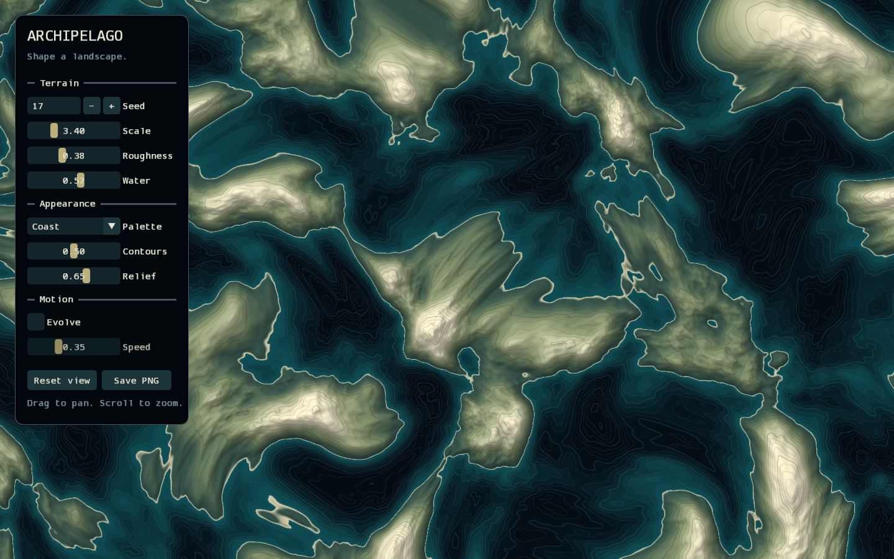

# Archipelago

Explore a procedural landscape built from Lygia's MIT-licensed simplex noise.
Shallow teal water surrounds muted terrain with pale ridges.
Contour lines show elevation. Directional light reveals the slopes.



Run from the repository root on Linux x86-64:

```bash
pixi run python tools/fetch_test_shaders.py
pixi run -e examples python -m examples.lygia --library .wesl/lygia
```

The fetch script downloads the noise files at a pinned revision.
It also copies their [MIT license](../../licenses/LYGIA-NOISE-MIT).
The example registers their directory with `dependencies={"lygia": library_directory}`.
The compiler resolves `import lygia::...` from that directory.
The binding does not download files or modify the library.
See [Lygia's license](https://lygia.xyz/license).

The noise and its math helpers originate in
[webgl-noise](https://github.com/stegu/webgl-noise) by Stefan Gustavson and Ian McEwan (Ashima Arts).
Lygia's [noise module](https://github.com/patriciogonzalezvivo/lygia/blob/ce08fe351478b6c14297d103a8ce98d8e787d4d2/generative/snoise.wesl)
declares the MIT license. The download preserves upstream comments and credits.
The palettes, color conversion, terrain composition, and viewer are local code.
This example does not use Lygia's Prosperity/Patron-licensed functions.

## Explore

The viewer starts with a still image.

- Change **Seed** to generate another landscape.
- Adjust **Scale**, **Roughness**, and **Water** to change its structure.
- Select **Coast**, **Copper**, or **Ink** for the palette.
- Adjust **Contours** and **Relief** to change the rendering.
- Enable **Evolve** for slow motion. **Speed** controls its rate.
- Drag to pan. Scroll to zoom around the pointer.
- **Reset view** restores the center and scale.
- **Save PNG** writes `landscape.png` in the current directory, without the panel.
  It replaces that file if it exists.

Seeds range from -2147483648 to 2147483647.
Choose a seed from the command line:

```bash
pixi run -e examples python -m examples.lygia --seed 42
```

Save the viewer, including its controls, without opening a window:

```bash
pixi run -e examples python -m examples.lygia --screenshot landscape.png
```

## Why WESL

[terrain.wesl](terrain.wesl) imports Lygia's three-dimensional simplex noise.
Two noise samples distort the coordinates.
Five octaves combine into an elevation field.
Time changes the third coordinate to evolve the landscape.

[palette.wesl](palette.wesl) defines three local color ramps.
The water level separates ocean colors from land colors.

[shaders/landscape.wesl](shaders/landscape.wesl) imports both operations.
One fragment shader evaluates the field at the current view coordinates.
Screen derivatives provide relief shading and smooth contour edges.
The `srgb_target` feature selects color conversion for an sRGB render target.

[renderer.py](renderer.py) compiles one pipeline and binds its uniforms.
[viewer.py](viewer.py) updates those uniforms from the controls.
Changes to the view and terrain do not recompile the shader.
Rendering stays on the GPU. PNG export reads the final image.

## Verify

```bash
pixi run -e testing python -m pytest tests/examples/lygia -q
```

Native shader tests verify elevation bounds, continuity, and palette bounds.
Render tests exercise the controls and compare sRGB and unorm output.
Viewer tests cover pause, motion, resizing, and PNG export.
The CLI test starts a fresh process and saves an offscreen image.
