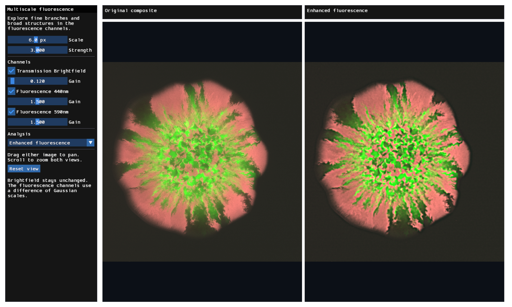

# Multiscale fluorescence

Run from the repository root:

```bash
pixi run -e examples python -m examples.multiscale
```

The viewer enhances GFP and RFP structures at an adjustable spatial scale.
Brightfield stays unchanged.
The [sample image](../imaging/README.md#sample-image) shows a bacterial colony
in brightfield and two fluorescence channels.



Enhanced fluorescence applies this filter to GFP and RFP:

```text
fine = Gaussian(image, sigma)
coarse = Gaussian(image, 2 * sigma)
enhanced = clip(image + strength * (fine - coarse), 0, 1)
```

Scale sets `sigma` in source pixels. Strength controls the enhancement.
Gaussian filters use radius `ceil(3 * sigma)` and clamp at image boundaries.
Channel gains and visibility affect the display separately.

[compute.py](compute.py) schedules the passes; [viewer.py](viewer.py) handles controls.
The shared [image library](../imaging/README.md#shared-operations) supplies convolution,
Gaussian weights, and boundary handling. The `horizontal` feature selects the axis.
Python uploads coefficients and sets the radius through override ID zero.

## Analysis views

Use the Analysis selector to change the right panel.
The left panel keeps the original composite.
The analyses use each channel before enhancement.
Display gains and channel visibility do not change the measurements.

The metadata identifies GFP and RFP, but does not specify what they label.
These views describe fluorescence patterns, not cell counts or population fractions.

### Channel correlation

Local Pearson correlation measures how GFP and RFP intensities vary together.
Scale sets the neighborhood size. Blue shows negative correlation, white shows zero,
and red shows positive correlation.

Max brightfield selects foreground pixels at or below the cutoff.
Background and neighborhoods with channel variance at most `1e-6` have no overlay.
The mask uses brightfield because fluorescence-based selection can induce negative
correlation between independent channels.

Two Gaussian passes combine running statistics with means stored as offsets.
This avoids subtracting raw intensity squares to recover small variances.

### Perimeter distance

The shader smooths GFP and RFP at the selected scale.
Min signal thresholds their sum to estimate the occupied region.
Its perimeter includes holes and the image border.
Channel balance and threshold affect this boundary.

Jump flooding estimates Euclidean distance to the nearest perimeter seed pixel.
Yellow shows nearby pixels; blue shows distant pixels.
Contours sets white-line spacing in source pixels.
Unoccupied regions and images without seeds have no overlay.

Profiles show original mean GFP and RFP intensities from occupied pixels in at most
64 intervals of equal width. They omit empty trailing intervals.
Contour spacing affects only the overlay.

### Polar view

Center X, Center Y, and Radius set the origin and extent in source pixels.
Defaults are `(916, 976)` and `880` pixels. The source origin is at the top left.
The horizontal axis runs clockwise from the right over `[0, 360)` degrees.
The vertical axis runs from the center to the radius.

Bilinear sampling preserves all three channels; samples outside the image are black.
Profiles show original mean GFP and RFP intensity by radius, including background
inside the image. They exclude out-of-image samples and omit empty trailing rings.
Scale and Strength do not apply. Radius does not represent elapsed time.

### Shared WESL modules

Kernels import `package::examples::imaging` with the repository as compiler root.
Enhancement and boundary estimation share `smooth()`.
Correlation imports the same Gaussian weights and boundary handling.
Profile kernels share [workgroup reduction](../imaging/reduction.wesl).

Select a named entry point to retain only its declarations and dependencies:

```python
shader = create_shader("profiles.wesl", dimensions, entry_point="accumulate_distance")
```

## Verify

```bash
pixi run -e testing python -m pytest tests/examples/test_multiscale.py -q
pixi run -e testing python -m pytest \
  tests/examples/test_multiscale_analysis.py tests/examples/multiscale \
  tests/examples/test_example_render.py -q
```

Synthetic tests need no TIFF download. They compare filters, correlation,
distances, polar samples, and profiles with NumPy.
Render tests cover each view and verify that display gains do not change correlation.
